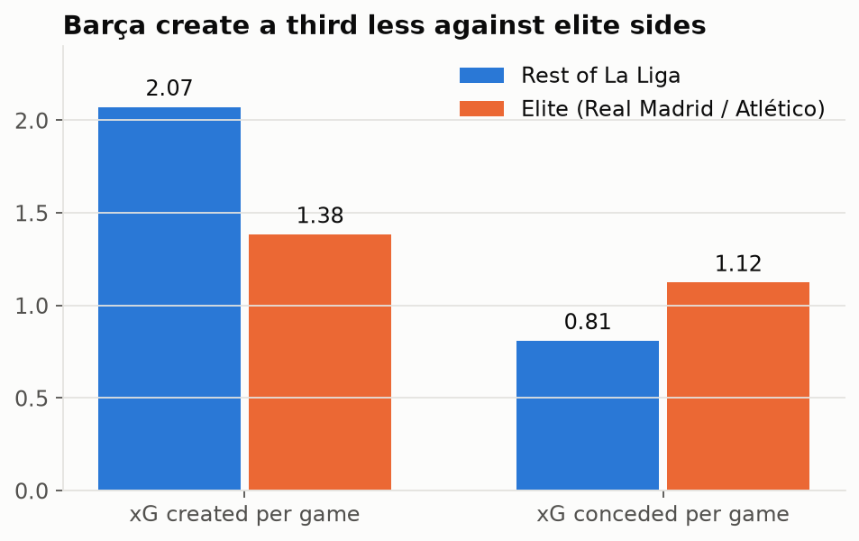
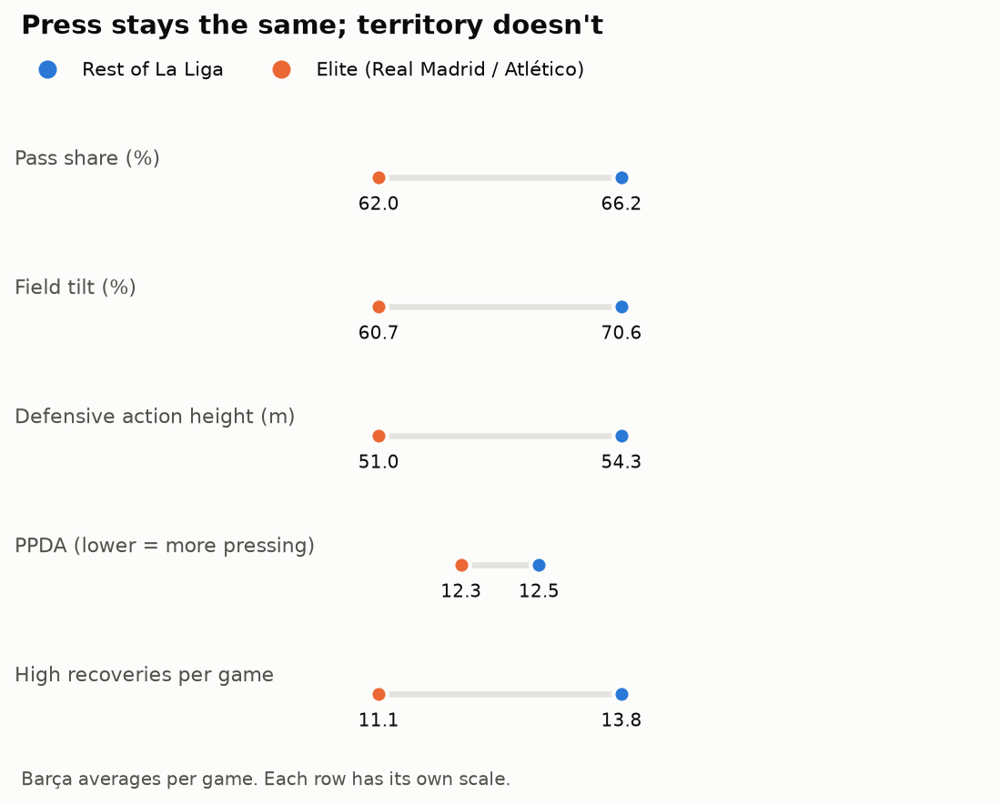
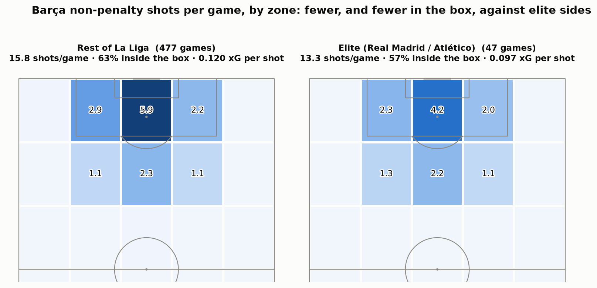
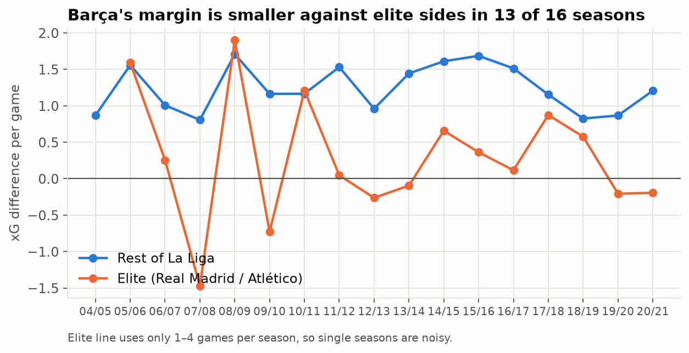
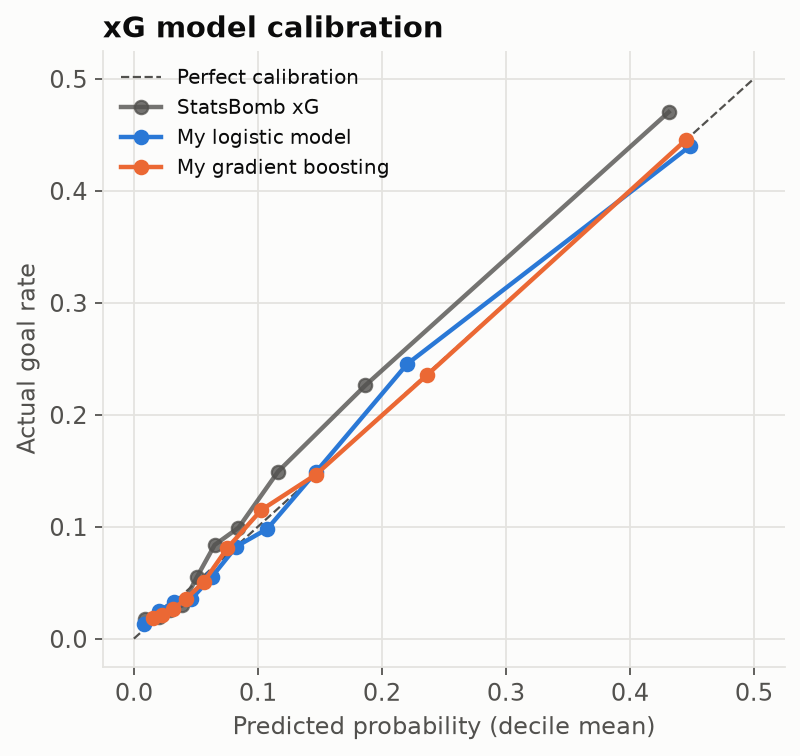

# Barça's big-game problem: is it real?

An end-to-end football analytics project on **3.1 million StatsBomb events**: 524 Barcelona La Liga matches
(2004/05 – 2020/21) plus the full 2015/16 season. It covers Python, SQL, statistical testing and a custom
expected-goals (xG) model.

**Question:** Barça dominate La Liga, but does that dominance hold against elite opponents (Real Madrid, and
Atlético from 2012/13)? If it shrinks, is that because elite teams stop Barça creating, or because they carve
Barça open?

➡️ **Full analysis: [`notebooks/analysis.ipynb`](notebooks/analysis.ipynb)**

## Key findings

| | vs rest of La Liga (477) | vs elite (47) |
|---|---:|---:|
| Points per game | 2.43 | 1.81 |
| xG created per game | 2.07 | 1.38 |
| xG conceded per game | 0.81 | 1.12 |
| **xG difference per game** | **+1.26** | **+0.26** |
| Final-third pass share (field tilt) | 70.6% | 60.7% |
| Defensive action height | 54.3 m | 51.0 m |
| PPDA (pressing intensity) | 12.5 | 12.3 |

1. **The gap is real.** The xG margin drops by 1.00 per game (bootstrap 95% CI 0.70–1.29; permutation p < 0.001).
2. **It's mostly an attacking problem.** About 70% of the drop is chances Barça stop creating, not extra chances they concede.
3. **The press survives; the territory doesn't.** Pressing intensity is unchanged, but Barça win the ball
   back 3.3 m deeper and lose 10 points of final-third share.
4. **Myth check:** counter-attacks make up a *smaller* share of the xG Barça concede against elite teams.
5. **Context:** every top team drops against other top teams (in 2015/16 Real Madrid's drop was bigger). Barça
   stayed positive against elite opponents until 2019–21.






## My expected-goals model

A logistic regression and a gradient-boosted model trained on 20,908 non-penalty shots. Features are shot
geometry, body part, shot type, play pattern, and two from the **freeze frame** (where every player stood at
the moment of the shot): defenders inside the shot cone, and goalkeeper position. Evaluated with 5-fold
cross-validation **grouped by match**, so no game appears in both train and test.

| Model | Log loss | Brier | ROC AUC |
|---|---:|---:|---:|
| StatsBomb xG (benchmark) | 0.286 | 0.083 | 0.815 |
| My gradient boosting | 0.291 | 0.085 | 0.805 |
| My logistic regression | 0.292 | 0.085 | 0.804 |

Both models land within ~2% of StatsBomb's own model using only public features.



## How it's built

```
src/fetch.py         download StatsBomb open data (cached, ~2.5 GB raw JSON, kept out of the repo)
src/build_tables.py  event JSON → tidy parquet: matches, team_match (xG, PPDA, field tilt, ...), shots
sql/queries.sql      the analysis as DuckDB SQL: joins, FILTER aggregates, window functions
src/run_sql.py       runs every named query → outputs/*.csv
src/xg_model.py      xG models with grouped cross-validation
src/charts.py        figures
notebooks/           the write-up, with significance tests and the 2015/16 benchmark
```

Reproduce:

```bash
python -m venv .venv && .venv/Scripts/activate      # macOS/Linux: source .venv/bin/activate
pip install -r requirements.txt
python src/fetch.py && python src/build_tables.py && python src/xg_model.py && python src/run_sql.py
jupyter nbconvert --to notebook --execute --inplace notebooks/analysis.ipynb
```

## Metric definitions

- **xG**: StatsBomb's expected goals per shot, summed per team per match.
- **PPDA**: opponent passes in their own 60% of the pitch ÷ Barça tackles, interceptions and fouls in that zone. Lower = more pressing.
- **Defensive action height**: mean distance from Barça's own goal line (0–120 m) of their duels, interceptions, recoveries, clearances, blocks, pressures and fouls.
- **Field tilt**: Barça's share of both teams' passes made in the final third.

## Limitations

- StatsBomb's open La Liga data covers only matches Messi played in, so it's a selected sample, and the
  Flick era (2024–26) isn't open.
- "Elite" is a fixed definition. A rolling Elo rating of opponent strength would be cleaner.
- The xG models are calibrated on a Barça-heavy sample (Barça scored ~14% above StatsBomb xG).

Data: [StatsBomb Open Data](https://github.com/statsbomb/open-data), used under its open-data licence.
Built by Kusal Kunwar.
